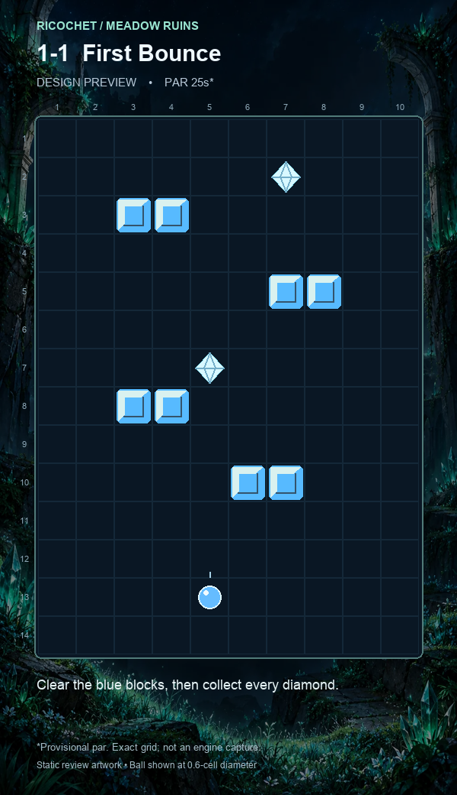
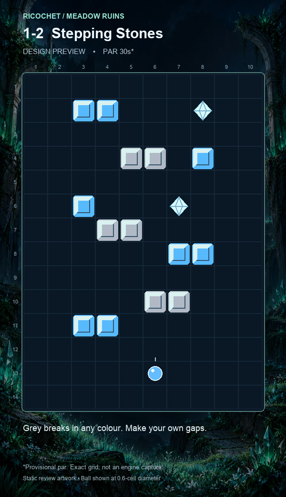
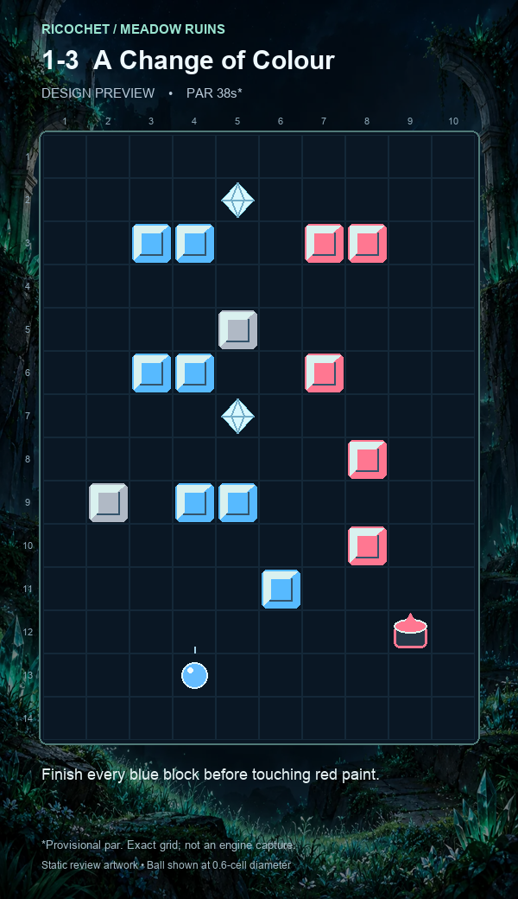
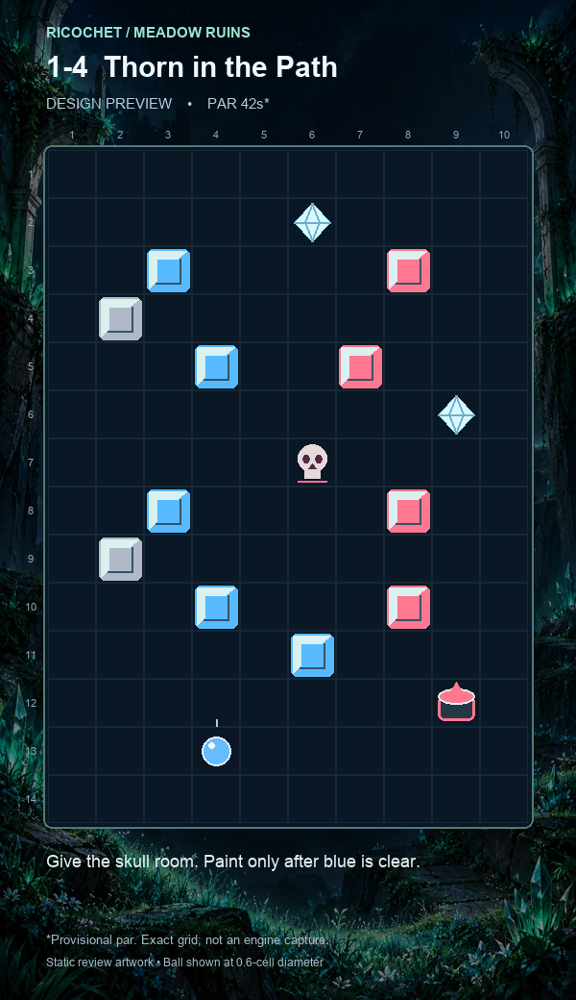
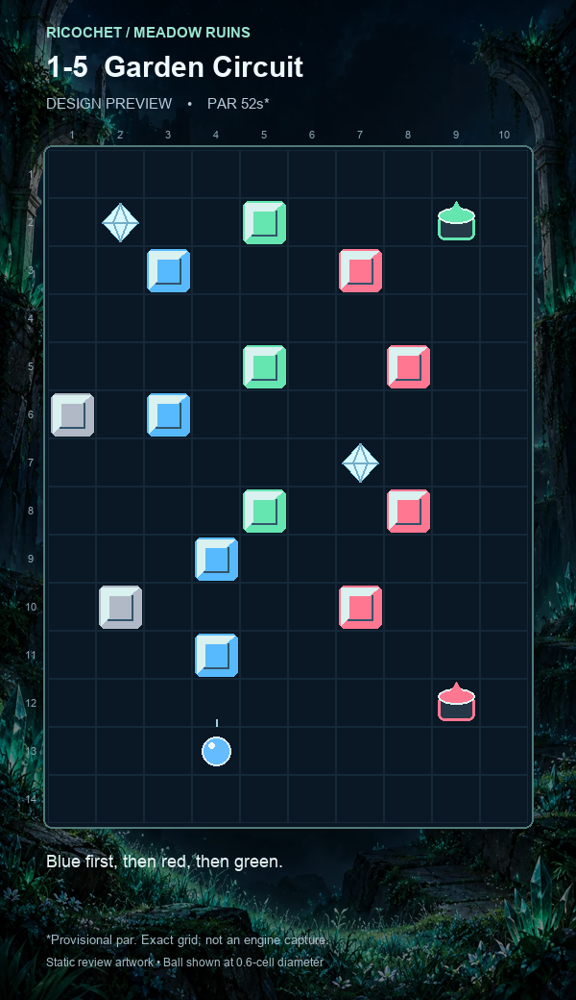
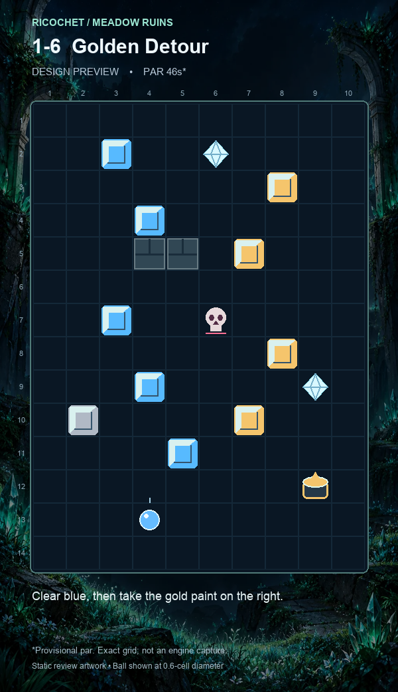
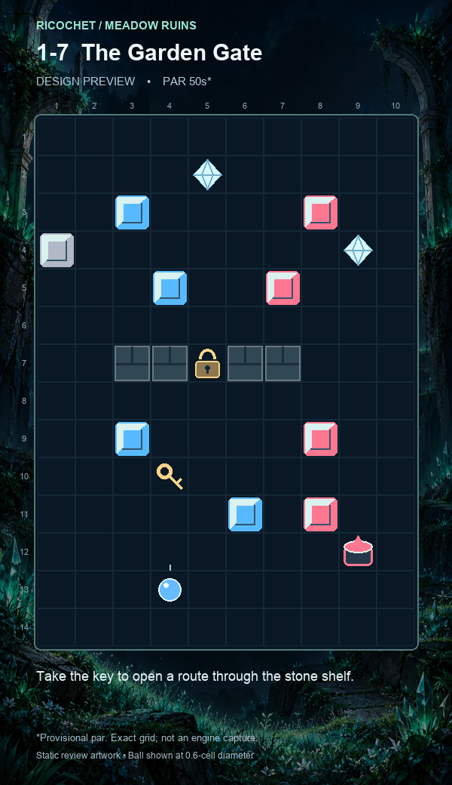
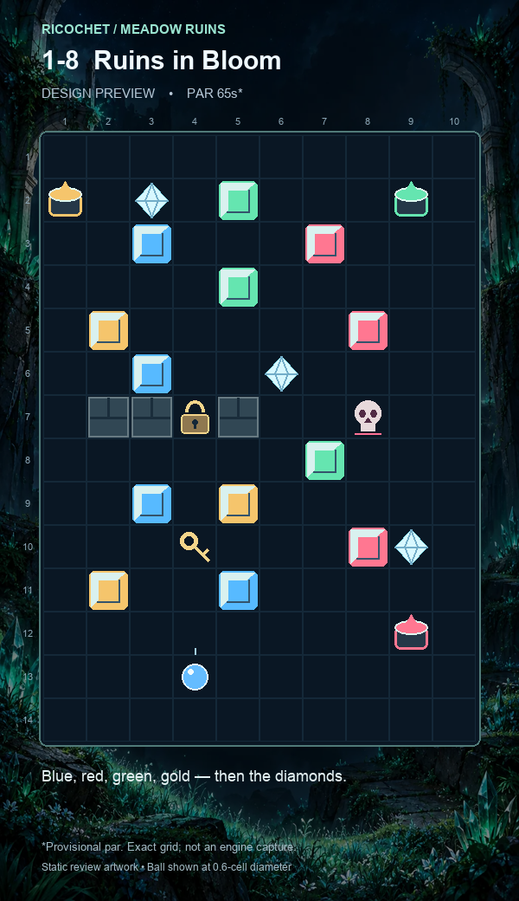

# Ricochet — Meadow Ruins, eight-level review

Version 0.2 · design candidates for engine playtesting.

The PNGs are accurate static renderings of the supplied grids, **not screenshots from the running game**. Their tile art is illustrative review art, not a new production asset pack. Par times are designer estimates, not measured completion times.

## Rules and integration

10 columns × 14 rows. Rows count downward; columns count from the left. Start blue, initially moving upward. Grid edges are solid. Use the exact grid strings in levels.json; do not infer collision boxes from the preview art.

Confirmed clarification: **paint pots persist. The ball dips inside the bucket, changes to its colour, and bounces back out. It never passes through.** The bucket can be used repeatedly. Keys and diamonds also bounce the ball. All paint is placed at the perimeter to reduce accidental repainting. None of the routes intentionally requires passing through a locked diamond or a key. Collecting a key should open its single lock; the resulting bounce still applies.

Grey blocks do not gate diamond activation or the win condition. Only a/b/c/d must be cleared first. Do not require grey clearance. Levels 1–3 have no skulls, and level 1 has no paint or other lethal object. There are no pits: the lower boundary bounces.

Provide a restart action: incorrect painting can strand blue or an earlier colour, particularly in levels without skulls. Safe solutions never require deliberate death. Restart behaviour, life count and death persistence are not specified by this handoff.

## Paint-bucket correction — 19 October 2026

This supersedes the earlier pass-through assumption. Read every “take paint” or “enter the pot” route step as dip, repaint, then rebound out. The grids are unchanged; routes and par times have not been revalidated in the engine with the confirmed bucket bounce. Entry aperture, side/underside collision response and animation duration remain implementation details to confirm. Do not infer those details from the static mockups.

## Movement review and limits

At 9 cells/s vertically and 5.5 sideways, maximum lateral displacement is 0.611 times vertical travel. A one-row jump cannot move a whole column. Keep turning through multiple rebounds instead of treating the route descriptions as consecutive one-bounce commands. The field is only 14 rows tall, so even the longest unobstructed vertical traversal takes about 1.56 seconds; intermediate shelves shorten it. That guarantees frequent physical bounces, not a useful destructible hit every two seconds after a poor steering choice.

The layouts use separated shelves throughout the field rather than a top stack. Wide detours are available around stone shelves and skulls. The one-cell gate has only 0.2-cell clearance on either side of a centred 0.6-cell ball; align before entering it. No safe route depends on an immediate sideways dodge at a skull.

Automated checks: every grid has 14 rows of 10 valid symbols, exactly one start, a paint source for each required non-blue colour, and matching key/lock counts. Initial straight-up contact is checked against the nearest solid object or boundary. These are structural checks, **not a collision simulation or proof of solvability**. Side collision response, acceleration, input latency and post-hit movement are engine-specific and remain untested.

Before shipping: run each safe route at the stated physics, then the faster route; test both faces of shelves, narrow-gate passage, locked-diamond rebound and the dip → repaint → bounce-out sequence, including repeated use of the same bucket. Verify restart recovery. Set pars from successful runs after tuning; the current values serve only as pacing proposals.

## Legend

`.` empty · `a` blue · `b` red · `c` green · `d` gold · `g` grey · `B` red pot · `C` green pot · `D` gold pot · `*` diamond · `x` skull · `#` wall · `k` key · `L` lock · `o` start.


## 1-1 — First Bounce

**Hint:** Clear the blue blocks, then collect every diamond.

**Teaches:** Steer while bouncing; diamonds wait until all coloured blocks are gone.

**Provisional par:** 25 seconds.

```text
..........
......*...
..aa......
..........
......aa..
..........
....*.....
..aa......
..........
.....aa...
..........
..........
....o.....
..........
```

**Solution:** Clear the lower blue shelves, weave through the middle shelves, then finish the upper pair. Return for both diamonds once the blue blocks are gone.

**Safe route:** Use broad outside arcs between shelves; there are no hazards or paint pots.

**Faster route:** Cut through the central gaps and aim each rebound toward the next shelf; missed angles only cost time.

**First contact:** approximately 0.58 seconds without steering.



## 1-2 — Stepping Stones

**Hint:** Grey breaks in any colour. Make your own gaps.

**Teaches:** Breakable grey shelves create temporary bounce surfaces and openings.

**Provisional par:** 30 seconds.

```text
..........
..aa...*..
..........
....gg.a..
..........
..a...*...
...gg.....
......aa..
..........
.....gg...
..aa......
..........
.....o....
..........
```

**Solution:** Use the lower grey shelf to change your route, then clear the blue pockets across the field. Grey blocks may remain when you take the two diamonds.

**Safe route:** Approach shelves from their wide outer ends and clear grey blocks when they obstruct an approach.

**Faster route:** Leave useful grey bounce surfaces intact and thread their ends to reach blue targets sooner.

**First contact:** approximately 0.24 seconds without steering.



## 1-3 — A Change of Colour

**Hint:** Finish every blue block before touching red paint.

**Teaches:** Painting is a commitment: blue cannot be restored without losing a life.

**Provisional par:** 38 seconds.

```text
..........
....*.....
..aa..bb..
..........
....g.....
..aa..b...
....*.....
.......b..
.g.aa.....
.......b..
.....a....
........B.
...o......
..........
```

**Solution:** Clear all seven blue blocks while staying out of the lower-right paint alcove. Enter the red pot, work back up the red shelves, then collect both diamonds.

**Safe route:** Keep to the left and centre until blue is cleared; enter the paint lane deliberately from above.

**Faster route:** Finish blue at row 11, column 6 and turn toward the pot immediately, saving a traversal.

**First contact:** approximately 0.36 seconds without steering.



## 1-4 — Thorn in the Path

**Hint:** Give the skull room. Paint only after blue is clear.

**Teaches:** Route around a single hazard without sacrificing colour order.

**Provisional par:** 42 seconds.

```text
..........
.....*....
..a....b..
.g........
...a..b...
........*.
.....x....
..a....b..
.g........
...a...b..
.....a....
........B.
...o......
..........
```

**Solution:** Clear blue on the left and lower centre, staying wide of the central skull. Paint red in the lower-right corner, clear the right-hand targets, then revisit the diamonds.

**Safe route:** Cross between halves below row 10 or above row 4; pass the skull in the far-left or far-right lanes.

**Faster route:** Use the central opening beside the skull to shorten the crossing; this requires earlier steering.

**First contact:** approximately 0.24 seconds without steering.



## 1-5 — Garden Circuit

**Hint:** Blue first, then red, then green.

**Teaches:** Plan a three-colour route and avoid a later paint pot until it is useful.

**Provisional par:** 52 seconds.

```text
..........
.*..c...C.
..a...b...
..........
....c..b..
g.a.......
......*...
....c..b..
...a......
.g....b...
...a......
........B.
...o......
..........
```

**Solution:** Clear blue in the left lane, take red at the lower right, then clear red as you climb. Take green at the upper right and clear the central green targets before the diamonds.

**Safe route:** Use the broad left lane for blue and stay below the upper green pot until red is complete.

**Faster route:** Finish red on its upper shelf and turn directly into green, then sweep down the central targets.

**First contact:** approximately 0.13 seconds without steering.



## 1-6 — Golden Detour

**Hint:** Clear blue, then take the gold paint on the right.

**Teaches:** Choose a wide safe detour or a shorter route near a hazard.

**Provisional par:** 46 seconds.

```text
..........
..a..*....
.......d..
...a......
...##.d...
..........
..a..x....
.......d..
...a....*.
.g....d...
....a.....
........D.
...o......
..........
```

**Solution:** Clear blue around the left end of the stone shelf, then take gold at the lower right. Clear the gold targets on the right and finish both diamonds.

**Safe route:** Pass left of the permanent shelf and use columns 8–10 to travel past the skull.

**Faster route:** Cut through column 7 between the shelf and the skull; set the steering direction well before row 7.

**First contact:** approximately 0.36 seconds without steering.



## 1-7 — The Garden Gate

**Hint:** Take the key to open a route through the stone shelf.

**Teaches:** A key creates a reusable shortcut; outer lanes remain an escape route.

**Provisional par:** 50 seconds.

```text
..........
....*.....
..a....b..
g.......*.
...a..b...
..........
..##L##...
..........
..a....b..
...k......
.....a.b..
........B.
...o......
..........
```

**Solution:** Collect the key in the lower chamber and clear blue on both sides of the stone shelf. Paint red, use the opened gate or the outer lane to reach the upper red targets, then collect the diamonds.

**Safe route:** Use the three-column right passage around the shelf; the two-column left passage is also open.

**Faster route:** Use the one-cell gate after unlocking it. Centre the ball before crossing; the 0.6-cell ball has only 0.2-cell clearance per side.

**First contact:** approximately 0.24 seconds without steering.



## 1-8 — Ruins in Bloom

**Hint:** Blue, red, green, gold — then the diamonds.

**Teaches:** Combine colour planning, a gate and one avoidable skull in a full-field route.

**Provisional par:** 65 seconds.

```text
..........
D.*.c...C.
..a...b...
....c.....
.d.....b..
..a..*....
.##L#..x..
......c...
..a.d.....
...k...b*.
.d..a.....
........B.
...o......
..........
```

**Solution:** Collect the key and clear all blue, then paint red at the lower right and clear red. Paint green at the upper right, clear its three targets, cross the upper field to gold at the far left, then clear gold and all three diamonds.

**Safe route:** Use the opened gate to change chambers and pass the skull through the central corridor. Enter each paint corner only when its preceding colour is complete.

**Faster route:** Use column 9 beside the skull and approach each next paint pot immediately after the final matching target; narrow clearances save distance but raise risk.

**First contact:** approximately 0.24 seconds without steering.


